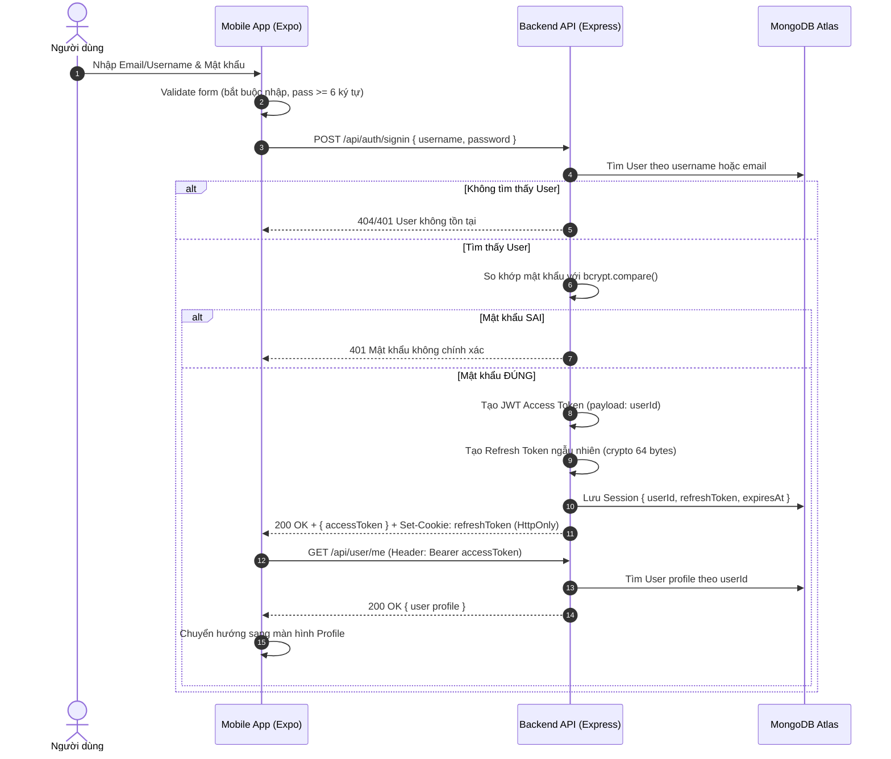
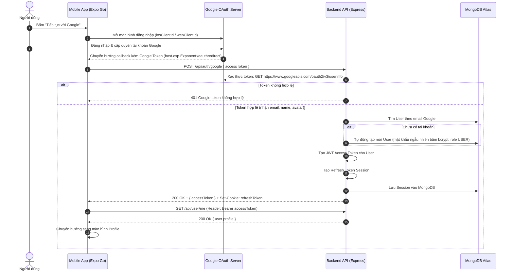
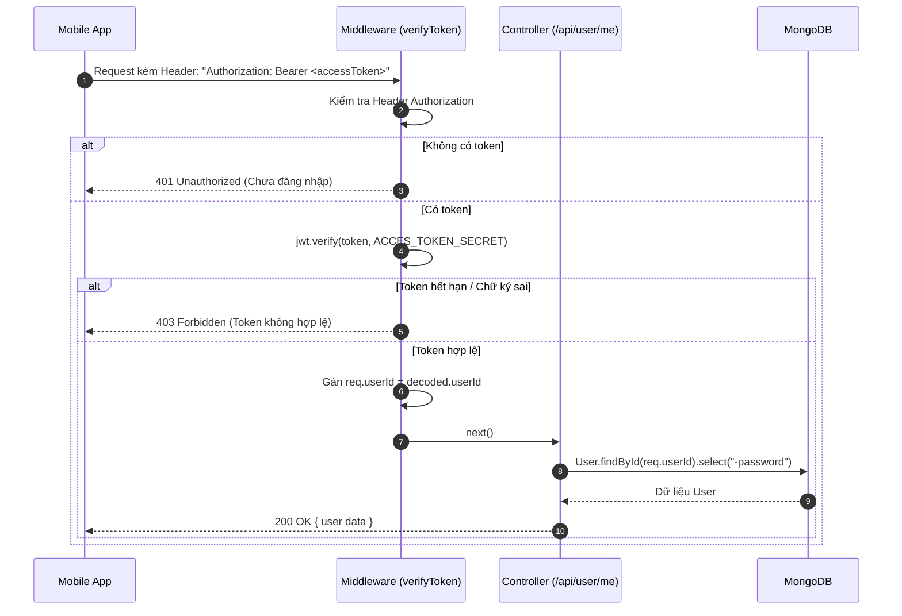
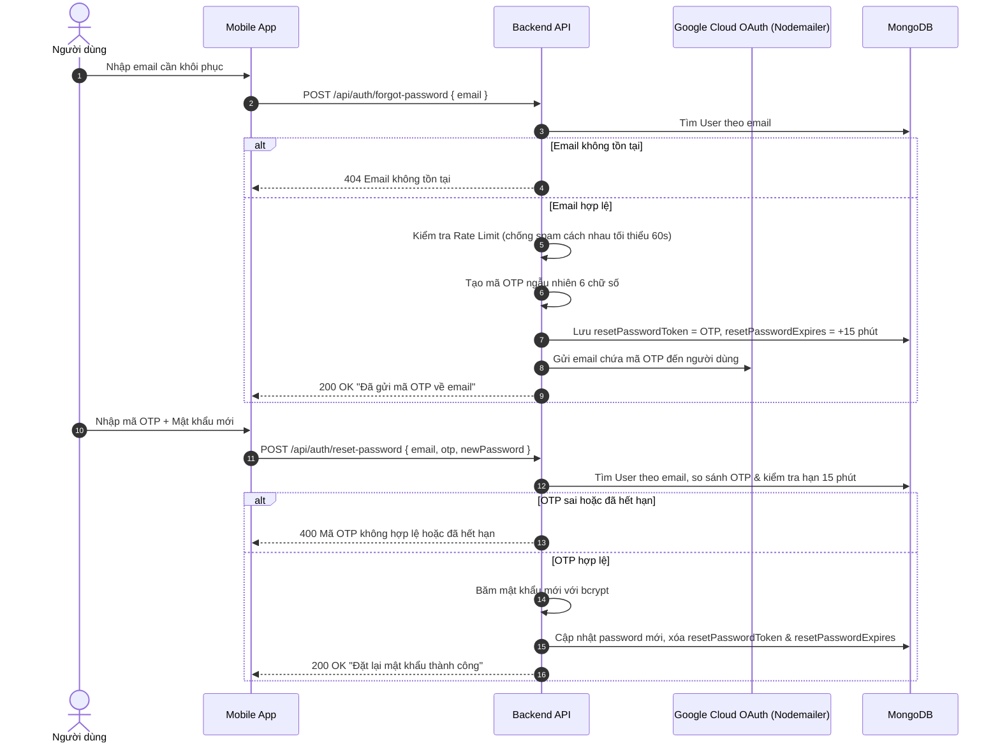

# 🔐 QUY TRÌNH HOẠT ĐỘNG AUTHENTICATION (JWT & GOOGLE OAUTH)
**Dự án:** Smart Travel Platform (Node.js/Express + MongoDB + React Native Expo)

---

## 📌 1. TỔNG QUAN KIẾN TRÚC BẢO MẬT

Hệ thống xác thực của Smart Travel áp dụng mô hình **Dual-Token Architecture (Access Token + Refresh Token)** kết hợp với **Google OAuth 2.0**:

- **Access Token (JWT):** Token ngắn hạn (Short-lived), dùng để chứng thực danh tính người dùng trong từng request gửi lên các API được bảo vệ (`Authorization: Bearer <token>`).
- **Refresh Token (Opaque Token):** Token dài hạn (Long-lived, 7 ngày), được tạo ngẫu nhiên bằng chuỗi bytes mật mã học (`crypto.randomBytes(64)`), lưu trong Database (`Session`) và gửi về client qua **HttpOnly Cookie** nhằm chống lại tấn công XSS.
- **Băm mật khẩu:** Mật khẩu của người dùng được mã hóa một chiều bằng thư viện `bcrypt` (10 salt rounds) trước khi lưu vào MongoDB.

---

## 🗺️ 2. SƠ ĐỒ QUY TRÌNH TỔNG THỂ (SEQUENCE DIAGRAM)

### 2.1 Luồng Đăng nhập Email & Mật khẩu (Standard JWT Flow)



---

### 2.2 Luồng Đăng nhập bằng Google (Google OAuth 2.0 Flow)



---

### 2.3 Luồng Xác thực Request được bảo vệ (Protected Route)



---

### 2.4 Luồng Quên mật khẩu & Đổi mật khẩu qua OTP (Forgot & Reset Password)



---

## ⚙️ 3. CÁC API ENDPOINTS AUTHENTICATION

| Method | Endpoint | Quyền truy cập | Chức năng | Body Payload mẫu |
|:---:|:---|:---:|:---|:---|
| `POST` | `/api/auth/signup` | Public | Đăng ký tài khoản mới | `{ username, email, password, confirmPassword, role }` |
| `POST` | `/api/auth/signin` | Public | Đăng nhập bằng Email/Username | `{ username, password }` |
| `POST` | `/api/auth/google` | Public | Đăng nhập bằng Google Token | `{ accessToken }` |
| `POST` | `/api/auth/forgot-password` | Public | Yêu cầu gửi mã OTP khôi phục | `{ email }` |
| `POST` | `/api/auth/reset-password` | Public | Đổi mật khẩu bằng mã OTP | `{ email, otp, newPassword }` |
| `POST` | `/api/auth/signout` | Public | Đăng xuất, hủy Session & Cookie | `{}` |
| `GET` | `/api/user/me` | Protected (JWT) | Lấy thông tin cá nhân của người dùng | Header: `Authorization: Bearer <token>` |

---

## 🛡️ 4. QUY TẮC BẢO MẬT & CHI TIẾT KỸ THUẬT

1. **Bảo mật Access Token:**
   - Được ký bằng khóa bí mật `ACCES_TOKEN_SECRET` trong file `.env`.
   - Thời hạn token được giới hạn ngắn nhằm giảm thiểu rủi ro khi token bị lộ.
   - Client lưu tạm thời trong Memory (State/Redux) khi app đang hoạt động.

2. **Bảo mật Refresh Token & Session:**
   - Tạo bằng mã hóa ngẫu nhiên: `crypto.randomBytes(64).toString('hex')`.
   - Được lưu vào Collection `sessions` trong MongoDB với thời gian hết hạn cụ thể (`expiresAt`).
   - Cài đặt Cookie với cờ an toàn cao:
     ```javascript
     res.cookie("refreshToken", refreshToken, {
       httpOnly: true, // Trình duyệt chặn mã độc JavaScript truy cập
       secure: true,   // Chỉ gửi qua kết nối HTTPS
       sameSite: "none", // Cho phép gửi chéo domain (mobile/web)
       maxAge: 7 * 24 * 60 * 60 * 1000 // 7 ngày
     });
     ```

3. **Cơ chế chống brute-force / spam mã OTP:**
   - Tại API `/api/auth/forgot-password`, hệ thống kiểm tra thời gian gửi mã trước đó. Nếu chưa qua 60 giây, trả về HTTP status `429 Too Many Requests`.
   - Mã OTP tự động vô hiệu hóa sau 15 phút.
