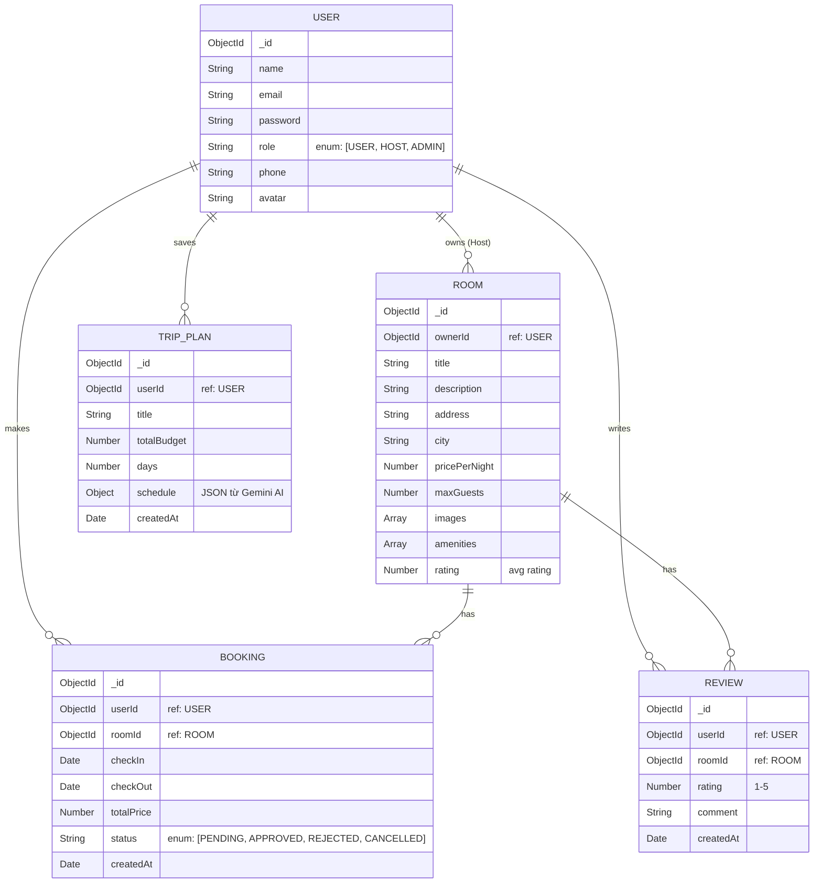

# Đề xuất Thiết kế Cơ sở Dữ liệu (MongoDB Schema)

Dưới đây là đề xuất cấu trúc Collections (Bảng) dùng Mongoose cho hệ thống **Smart Travel**:

## 1. ERD Diagram (Sơ đồ thực thể)

## 2. Chi tiết các Schema (Mongoose Model)

### 2.1. `User` Schema
Lưu trữ thông tin tài khoản chung. Phân quyền bằng trường `role`.
- `name`: Tên người dùng.
- `email`: Đăng nhập (Unique).
- `password`: Mật khẩu (đã băm bcrypt).
- `role`: Enum `['USER', 'HOST', 'ADMIN']`. (Mặc định: `USER`).
- `phone`: Số điện thoại.
- `avatar`: URL ảnh đại diện.

### 2.2. `Room` Schema (Homestay/Khách sạn)
Do `HOST` tạo và quản lý.
- `ownerId`: Tham chiếu tới `User` (Role `HOST`).
- `title`: Tên phòng/homestay.
- `address`, `city`: Địa chỉ.
- `pricePerNight`: Giá một đêm.
- `maxGuests`: Số người tối đa.
- `images`: Mảng URL ảnh (Lưu trên Cloudinary hoặc local uploads).
- `amenities`: Mảng String (VD: `['Wifi', 'Bể bơi', 'BBQ']`).
- `rating`: Số sao trung bình (Cập nhật khi có Review mới).

### 2.3. `Booking` Schema
Đơn đặt phòng do `USER` tạo, `HOST` duyệt.
- `userId`: Người đặt.
- `roomId`: Phòng được đặt.
- `checkIn`, `checkOut`: Ngày nhận/trả.
- `totalPrice`: Tổng tiền (tự tính: số ngày * giá phòng).
- `status`: Enum `['PENDING', 'APPROVED', 'REJECTED', 'COMPLETED']`. (Mặc định `PENDING`).

### 2.4. `Review` Schema
Đánh giá từ khách hàng sau khi ở.
- `userId`: Người đánh giá.
- `roomId`: Phòng bị đánh giá.
- `rating`: Số sao (1 đến 5).
- `comment`: Nội dung đánh giá.

### 2.5. `TripPlan` Schema (Lịch trình AI)
Lưu lại các lịch trình do AI tạo ra mà user muốn lưu trữ.
- `userId`: Thuộc về user nào.
- `title`: Tên chuyến đi (VD: "Phượt Đà Lạt 3 ngày 2 đêm").
- `totalBudget`: Ngân sách.
- `days`: Số ngày.
- `schedule`: Dữ liệu JSON thô do Gemini AI trả về (Nested Object hoặc Array lưu chi tiết các ngày, địa điểm).
