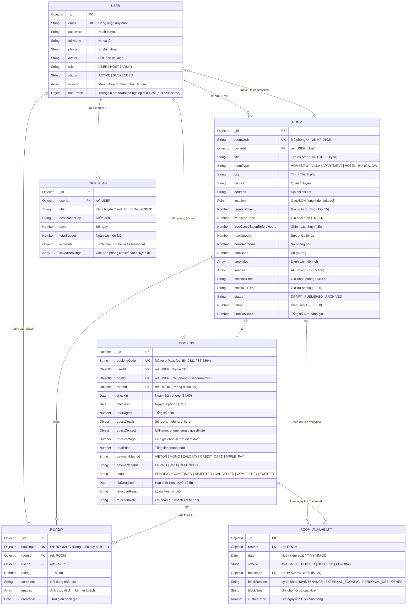

# Thiết kế Cơ sở Dữ liệu Hệ thống Smart Travel (MongoDB Schema)

Tài liệu đặc tả kiến trúc cơ sở dữ liệu (Database Schema) dùng **MongoDB & Mongoose** cho nền tảng **Smart Travel**, phục vụ đồng bộ hai phân hệ chính: **Host Web Portal** (Đối tác lưu trú) và **Visitor Mobile App** (Khách du lịch).

---

## 1. Sơ đồ thực thể ERD (Entity Relationship Diagram)



---

## 2. Chi tiết các Mongoose Model

### 2.1. `User` Model

Quản lý thông tin tài khoản cho cả 3 vai trò (`USER`, `HOST`, `ADMIN`).

```javascript
import mongoose from 'mongoose';

const UserSchema = new mongoose.Schema({
  email: { 
    type: String, 
    required: [true, 'Email là bắt buộc'], 
    unique: true, 
    lowercase: true, 
    trim: true,
    index: true 
  },
  password: { 
    type: String, 
    required: [true, 'Mật khẩu là bắt buộc'] 
  },
  fullName: { 
    type: String, 
    required: [true, 'Họ và tên là bắt buộc'], 
    trim: true 
  },
  phone: { 
    type: String, 
    trim: true 
  },
  avatar: { 
    type: String, 
    default: '' 
  },
  role: { 
    type: String, 
    enum: ['USER', 'HOST', 'ADMIN'], 
    default: 'USER',
    index: true 
  },
  status: {
    type: String,
    enum: ['ACTIVE', 'SUSPENDED'],
    default: 'ACTIVE'
  },
  // Danh sách homestay yêu thích của khách (Đồng bộ với màn hình SCR-MOB-ACC-03)
  wishlist: [{ 
    type: mongoose.Schema.Types.ObjectId, 
    ref: 'Room' 
  }],
  // Hồ sơ đối tác dành riêng cho HOST
  hostProfile: {
    businessName: { type: String, trim: true },
    isVerified: { type: Boolean, default: false }
  },
  // Hỗ trợ khôi phục mật khẩu
  resetPasswordToken: { type: String },
  resetPasswordExpires: { type: Date }
}, { timestamps: true });

export default mongoose.model('User', UserSchema);
```

---

### 2.2. `Room` Model

Quản lý cơ sở lưu trú của Host, đáp ứng trọn vẹn quy trình tạo phòng, lưu nháp, đăng bán và tìm kiếm bản đồ.

```javascript
import mongoose from 'mongoose';

const RoomSchema = new mongoose.Schema({
  // Mã phòng hiển thị trên UI (vd: "MP-0102" hoặc "P-VL204")
  roomCode: { 
    type: String, 
    required: true, 
    unique: true, 
    uppercase: true, 
    trim: true,
    index: true 
  },
  ownerId: { 
    type: mongoose.Schema.Types.ObjectId, 
    ref: 'User', 
    required: true, 
    index: true 
  },
  title: { 
    type: String, 
    required: true, 
    minlength: 10, 
    maxlength: 150, 
    trim: true 
  },
  roomType: { 
    type: String, 
    enum: ['HOMESTAY', 'VILLA', 'APARTMENT', 'HOTEL', 'BUNGALOW'], 
    required: true,
    default: 'HOMESTAY'
  },

  // Địa chỉ & Tọa độ GPS
  city: { type: String, required: true, index: true },
  district: { type: String, required: true },
  address: { type: String, required: true },
  location: {
    type: { type: String, enum: ['Point'], default: 'Point' },
    coordinates: { type: [Number], required: true } // [longitude, latitude]
  },

  // Thông số phòng & Sức chứa
  maxGuests: { type: Number, required: true, min: 1, max: 50, default: 2 },
  numBedrooms: { type: Number, required: true, min: 1, default: 1 },
  numBeds: { type: Number, required: true, min: 1, default: 1 },

  // Chính sách giá & Giờ giấc
  regularPrice: { type: Number, required: true, min: 50000 }, // Giá ngày thường (T2 - T5)
  weekendPrice: { type: Number }, // Giá Thứ 6 - CN (nếu bỏ trống = regularPrice)
  freeCancellationBeforeHours: { type: Number, default: 48 }, // Miễn phí hủy trước 48h
  checkInTime: { type: String, default: '14:00' },
  checkOutTime: { type: String, default: '12:00' },

  description: { type: String, required: true, minlength: 50, maxlength: 1000 },
  amenities: [{ type: String, required: true }],
  images: [{ type: String, required: true }], // Tối thiểu 3, tối đa 15 ảnh (ảnh [0] là ảnh đại diện)

  // Vòng đời phòng: DRAFT (Nháp) | PUBLISHED (Mở bán) | ARCHIVED (Tạm dừng/Bảo trì)
  status: { 
    type: String, 
    enum: ['DRAFT', 'PUBLISHED', 'ARCHIVED'], 
    default: 'DRAFT', 
    index: true 
  },

  // Điểm đánh giá tích lũy
  rating: { type: Number, default: 0, min: 0, max: 5 },
  numReviews: { type: Number, default: 0 }
}, { timestamps: true });

// Hỗ trợ tìm kiếm theo bán kính vị trí trên bản đồ
RoomSchema.index({ location: '2dsphere' });
RoomSchema.index({ ownerId: 1, status: 1 });

export default mongoose.model('Room', RoomSchema);
```

---

### 2.3. `Booking` Model

Quản lý đơn đặt phòng, liên kết vé điện tử e-Pass và đồng hồ đếm ngược SLA 24h.

```javascript
import mongoose from 'mongoose';

const BookingSchema = new mongoose.Schema({
  // Mã vé e-Pass hiển thị trên UI (vd: "BK-9821" hoặc "ST-5894")
  bookingCode: { 
    type: String, 
    required: true, 
    unique: true, 
    uppercase: true,
    index: true 
  },
  userId: { type: mongoose.Schema.Types.ObjectId, ref: 'User', required: true, index: true },
  hostId: { type: mongoose.Schema.Types.ObjectId, ref: 'User', required: true, index: true }, // Denormalized để tăng tốc Dashboard của Host
  roomId: { type: mongoose.Schema.Types.ObjectId, ref: 'Room', required: true, index: true },

  // Thời gian lưu trú
  checkIn: { type: Date, required: true },
  checkOut: { type: Date, required: true },
  totalNights: { type: Number, required: true, min: 1 },

  // Chi tiết đoàn khách
  guestDetails: {
    adults: { type: Number, required: true, min: 1, default: 1 },
    children: { type: Number, default: 0 }
  },

  // Thông tin liên hệ & Yêu cầu đặc biệt
  guestContact: {
    fullName: { type: String, required: true },
    phone: { type: String, required: true },
    email: { type: String },
    guestNote: { type: String, maxlength: 500 } // Lời nhắn nhận phòng sớm, tiện ích...
  },

  // Giá & Thanh toán
  pricePerNight: { type: Number, required: true },
  totalPrice: { type: Number, required: true },
  paymentMethod: { 
    type: String, 
    enum: ['VIETQR', 'MOMO', 'ZALOPAY', 'CREDIT_CARD', 'APPLE_PAY'], 
    default: 'VIETQR' 
  },
  paymentStatus: {
    type: String,
    enum: ['UNPAID', 'PAID', 'REFUNDED'],
    default: 'PAID'
  },

  // Trạng thái đơn đặt phòng
  status: { 
    type: String, 
    enum: ['PENDING', 'CONFIRMED', 'REJECTED', 'CANCELLED', 'COMPLETED', 'EXPIRED'], 
    default: 'PENDING',
    index: true 
  },
  slaDeadline: { type: Date, required: true }, // Hạn chót duyệt 24h từ lúc tạo đơn
  rejectionReason: { 
    type: String,
    enum: [
      'Trùng lịch / Phòng bận ngoài hệ thống',
      'Cơ sở lưu trú đang bảo trì / sửa chữa',
      'Không đáp ứng được yêu cầu đặc biệt của khách',
      'Lý do bất khả kháng / Thiên tai, thời tiết',
      'Khác'
    ]
  },
  rejectionNote: { type: String, maxlength: 200 }
}, { timestamps: true });

BookingSchema.index({ hostId: 1, status: 1 });
BookingSchema.index({ roomId: 1, checkIn: 1, checkOut: 1 });

export default mongoose.model('Booking', BookingSchema);
```

---

### 2.4. `RoomAvailability` Model

Kiểm soát tình trạng trống/bận theo từng ngày của phòng, chống Overbooking và cho phép Host chủ động khóa lịch bảo trì.

```javascript
import mongoose from 'mongoose';

const RoomAvailabilitySchema = new mongoose.Schema({
  roomId: { type: mongoose.Schema.Types.ObjectId, ref: 'Room', required: true, index: true },
  date: { type: Date, required: true }, // Ngày theo định dạng YYYY-MM-DD
  status: { 
    type: String, 
    enum: ['AVAILABLE', 'BOOKED', 'BLOCKED', 'PENDING'], 
    default: 'AVAILABLE' 
  },
  bookingId: { type: mongoose.Schema.Types.ObjectId, ref: 'Booking' }, // Gắn với đơn phòng nếu đã Booked
  blockReason: { 
    type: String, 
    enum: ['MAINTENANCE', 'EXTERNAL_BOOKING', 'PERSONAL_USE', 'OTHER'] 
  },
  blockNote: { type: String, maxlength: 100 }, // Ghi chú nội bộ hiển thị trên ô lịch
  customPrice: { type: Number } // Phụ thu ngày lễ / Giảm giá ngày đặc biệt
}, { timestamps: true });

// Khóa chỉ mục kép: Đảm bảo 1 phòng không bao giờ tồn tại 2 bản ghi trùng ngày
RoomAvailabilitySchema.index({ roomId: 1, date: 1 }, { unique: true });

export default mongoose.model('RoomAvailability', RoomAvailabilitySchema);
```

---

### 2.5. `Review` Model

Lưu đánh giá từ khách du lịch sau khi hoàn tất chuyến đi (xác thực chặt chẽ qua `bookingId`).

```javascript
import mongoose from 'mongoose';

const ReviewSchema = new mongoose.Schema({
  // Ràng buộc duy nhất: Mỗi booking chỉ được review đúng 1 lần
  bookingId: { 
    type: mongoose.Schema.Types.ObjectId, 
    ref: 'Booking', 
    required: true, 
    unique: true 
  },
  roomId: { type: mongoose.Schema.Types.ObjectId, ref: 'Room', required: true, index: true },
  userId: { type: mongoose.Schema.Types.ObjectId, ref: 'User', required: true },
  rating: { type: Number, required: true, min: 1, max: 5 },
  comment: { type: String, required: true, minlength: 5, maxlength: 1000 },
  images: [{ type: String }], // Tối đa 5 ảnh chụp thực tế từ du khách
  // Tiêu chí đánh giá chi tiết (khớp giao diện WriteReviewScreen)
  categories: {
    cleanliness: { type: Number, min: 1, max: 5 }, // Vệ sinh
    location:    { type: Number, min: 1, max: 5 }, // Vị trí
    service:     { type: Number, min: 1, max: 5 }, // Dịch vụ
    roomAmenities:  { type: Number, min: 1, max: 5 }, // Tiện nghi phòng
    value:       { type: Number, min: 1, max: 5 }  // Giá trị
  },
  fullName: { type: String, trim: true },
  avatar: { type: String, default: '' },
  bookingCode: { type: String, default: '' },
  helpful: { type: Number, default: 0 }
}, { timestamps: true });

ReviewSchema.index({ roomId: 1, createdAt: -1 });

export default mongoose.model('Review', ReviewSchema);
```

---

### 2.6. `TripPlan` Model

Lưu trữ lịch trình du lịch thông minh do Gemini AI tạo ra.

```javascript
import mongoose from 'mongoose';

const TripPlanSchema = new mongoose.Schema({
  userId: { type: mongoose.Schema.Types.ObjectId, ref: 'User', required: true, index: true },
  title: { type: String, required: true },
  destinationCity: { type: String, required: true },
  days: { type: Number, required: true, min: 1 },
  totalBudget: { type: Number, required: true },
  schedule: { type: mongoose.Schema.Types.Mixed, required: true }, // Dữ liệu JSON chi tiết từ Gemini AI
  linkedBookings: [{ type: mongoose.Schema.Types.ObjectId, ref: 'Booking' }]
}, { timestamps: true });

export default mongoose.model('TripPlan', TripPlanSchema);
```

---

## 3. Tổng kết các điểm cấu hình nghiệp vụ trọng tâm

1. **Loại bỏ SmartLock:** Khách check-in trực tiếp bằng mã vé điện tử e-Pass (`bookingCode`) và mã QR hiển thị trên màn hình Mobile App hoặc giao nhận chìa khóa trực tiếp với Host.
2. **Cập nhật Wishlist (`User.wishlist`):** Đồng bộ danh sách homestay yêu thích từ Mobile App lên Server.
3. **Cập nhật Phương thức thanh toán (`Booking.paymentMethod`):** Hệ thống áp dụng cơ chế thanh toán giả lập (Simulated Payment), lưu lại phương thức người dùng lựa chọn (`VIETQR`, `MOMO`, `ZALOPAY`, `CREDIT_CARD`, `APPLE_PAY`) để mô phỏng luồng hoàn tất đơn phòng.
4. **Loại bỏ thông tin tài khoản ngân hàng (`bankAccount`):** Do phạm vi dự án hiện tại không bao gồm tính năng rút tiền về tài khoản của Host (Out of Scope), trường `bankAccount` được loại bỏ hoàn toàn khỏi Schema để giữ kiến trúc dữ liệu tinh gọn (Lean Data Model), tránh phát sinh trường rác.
5. **Vòng đời phòng chuẩn Host Portal:** Hỗ trợ 3 trạng thái `DRAFT` (Lưu nháp / Auto-save), `PUBLISHED` (Đang mở bán) và `ARCHIVED` (Tạm ngưng đón khách).
6. **Hiệu năng Dashboard Host:** Thuộc tính `hostId` được denormalize vào `Booking` giúp tính toán doanh thu và tỷ lệ lấp đầy mà không cần `$lookup` phức tạp.
