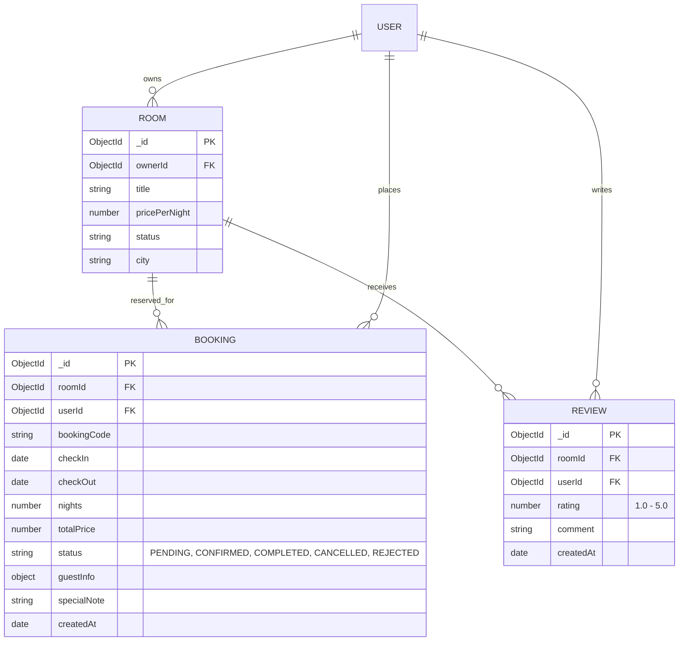

# Data Model: View Dashboard (SMART-110)

**Feature**: View Dashboard (`SMART-110`)  
**Parent Ticket**: `SMART-107`  
**Date**: 2026-10-24  
**Status**: Completed  

---

## 1. Entities & Data Models

### 1.1 Existing Models Leveraged



---

## 2. DTOs & API Response Schemas

### 2.1 Dashboard Overview DTO (`DashboardOverviewResponse`)

```typescript
interface DashboardOverviewResponse {
  success: boolean;
  message: string;
  data: {
    host: {
      id: string;
      name: string;
      email: string;
      initials: string;
    };
    period: 'TODAY' | '7_DAYS' | '30_DAYS' | 'THIS_MONTH' | 'LAST_MONTH';
    periodLabel: string; // "30 ngày qua"
    slaAlert: {
      hasPending: boolean;
      pendingCount: number;
      urgentBookingCode: string; // "#BK-9819"
      urgentExpireHours: number; // 3
      message: string; // "Bạn có 2 đơn chờ duyệt, trong đó 1 đơn (#BK-9819) sẽ hết hạn sau 3 giờ."
    } | null;
    kpis: {
      revenue: {
        value: number; // 45200000
        formatted: string; // "45.2 M VND"
        confirmedBookingsCount: number; // 14
        subBadge: string; // "14 đơn hoàn thành & đã xác nhận"
      };
      newBookings: {
        count: number; // 18
        formatted: string; // "18 đơn"
        autoCloseRate: number; // 82
        subBadge: string; // "Tỷ lệ chốt đơn tự động 82%"
      };
      occupancyRate: {
        percentage: number; // 68
        formatted: string; // "68%"
      };
      avgRating: {
        score: number; // 4.7
        formatted: string; // "4.7 ★"
        totalReviewsCount: number; // 32
      };
    };
    chart: {
      mode: 'REVENUE' | 'BOOKINGS';
      selectedRoomId: string; // "ALL" | RoomId
      roomsList: Array<{
        id: string;
        title: string;
      }>;
      timeline: Array<{
        date: string; // "2026-10-15"
        label: string; // "15/10"
        revenue: number; // 5000000
        bookingsCount: number; // 2
        details: string; // "2 đơn (Villa Mộng Mơ & Ocean View)"
      }>;
      summary: {
        dailyAverage: number; // 1506000
        dailyAverageFormatted: string; // "1.506.000 đ"
        peakRevenue: number; // 7500000
        peakDate: string; // "20/10"
        peakRevenueFormatted: string; // "7.500.000 đ (Ngày 20/10)"
      };
    };
    schedule: {
      activeTab: 'TODAY' | 'TOMORROW';
      todayCount: number; // 4
      tomorrowCount: number; // 2
      today: Array<ScheduleGuestItem>;
      tomorrow: Array<ScheduleGuestItem>;
    };
    recentReviews: {
      overallRating: number; // 4.7
      totalReviews: number; // 32
      list: Array<RecentReviewItem>;
    };
  };
}

interface ScheduleGuestItem {
  id: string;
  bookingCode: string;
  guestName: string;
  initials: string;
  roomName: string;
  maskedPhone: string; // "0912.***.678"
  type: 'CHECK_IN' | 'CHECK_OUT';
  time: string; // "14:00" | "12:00"
  statusBadge: string; // "🟢 Check-in 14:00" | "🔵 Check-out 12:00"
  specialNote?: string; // "Yêu cầu: Đón tại sân bay" | "Phòng đã dọn sạch"
}

interface RecentReviewItem {
  id: string;
  guestName: string;
  initials: string;
  rating: number; // 5
  roomName: string; // "Villa Mộng Mơ"
  date: string; // "13/10/2026"
  comment: string;
}
```
